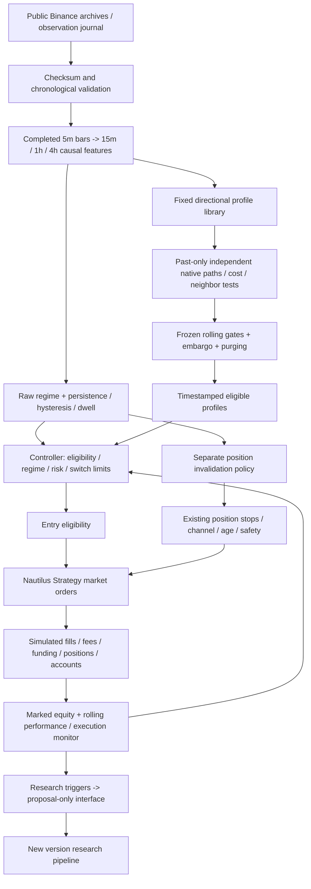

# V2 architecture and V1 lessons

All experiment code and results live under `evaluation/adaptive_trading_v2/`.
NautilusTrader core and both reference branches remain unchanged. The experiment
branches directly from develop, with no reference merges. V1's original autopsy
checksum reconciliation is run read-only against an extracted commit snapshot.

## Modules and trust boundaries

`features.py` retains V1's causal completed-bar calculations and backward joins.
`regime.py` adds a separate stable state machine and preserves raw control labels.
`profiles.py` is immutable and directional, with a bounded diagnostic neighborhood.
`native.py` copies the previously audited V1 native execution scaffold, adapted
locally for continuous V2 execution and observed shadow events. Immutable native
events may be cached by complete input digest; full-account replay equality is tested.
`runtime.py` implements the same strategy callbacks for backtest and public shadow.
`evidence.py` exposes matured rolling records, with expiration and no future reads.
`controller.py` selects only existing eligible profiles and discrete risk levels.
`research.py` writes structured hypotheses without access to activation interfaces.
`shadow.py` collects public events and reconstructs state through native replay.
`shadow_validation.py` regenerates monthly evidence using the unchanged evaluator.

The research process may propose anything as text; it cannot create executable
profile parameters, change gate results, or edit a frozen bundle. New proposals
require RESEARCH -> BACKTEST -> WALK_FORWARD -> COST_STRESS -> STABILITY ->
SHADOW_ELIGIBLE, a reviewed new version and new prospective freeze. Automatic
monthly validation of unchanged frozen profiles updates evidence only.

## Lessons incorporated

| V1 finding | V2 response |
|---|---|
| Weak strategy library | Six predeclared specialized directional profiles; no revived mean reversion/pullback without a new thesis |
| No eligible profiles and zero adaptive trades | Explicit exercise accounting; fixture proves switching mechanics but only historical native trades count as economic exercise |
| Trend exits 93–97% coincident with incompatible labels | Entry permission and position invalidation are separate; complete four-policy reruns |
| Raw labels fluctuate and confidence was uncalibrated | Hourly persistence, dwell, distinct entry/exit hysteresis and recorded candidate confidence; confidence remains explicitly uncalibrated |
| Positive regime/side slices were hindsight observations | Hypotheses predeclared; no inherited admissions or deleted-trade counterfactuals |
| Ten-winner removal rejects positively skewed distributions | Multiple concentration diagnostics and calendar-block resampling; meaningful tail/symbol/month gates remain |
| Stress tests absent on neighbors | Every central treatment and every distinct neighbor receives all three cost scenarios |
| Exposure mismatch obscured comparisons | Allocated-capital, volatility, marked drawdown, exposure, turnover and return/exposure; restrained passive allocation |
| Boundary resets weakened pseudo-live fidelity | No monthly account/position resets; continuous native simulation |
| Unordered closed-trade drawdown | Marked daily equity drawdown for all performance and gate decisions |
| Transition counts multiplied across repeated runs | Count a single unique market path per symbol; scenario logs are repetitions |
| Previously used holdout history | All data through September 2026 labeled CONSUMED and RETROSPECTIVE_EVIDENCE |
| No persistent forward runtime | Immutable public observation journal, native replay, monthly validation and deployment templates |

## Engineering corrections

The initial implementation delayed a stress transition to the hourly update,
contrary to the predeclared immediate stress exception. It was corrected without
changing thresholds; the feature cache was rebuilt and all affected runs rerun.
Those superseded engineering runs are not included in final results. Native event
caching was added to avoid rebuilding identical immutable inputs. Two complete
replays matched the pre-cache financial/event result exactly. The final source
fingerprint and feature-cache manifest must match every retained final run.

The prospective monthly evaluator was checked against an actual historical native
path prefix: closed trades, fills and funding transfers matched exactly through
the matured cutoff. It uses continuous execution from January 2024 and no cutoff
liquidation; only the evidence evaluator slices the rolling window. A mid-month
deployment can initialize current evidence at actual completion. Later deployment
backfills the consumed-to-start gap for training only, with paginated funding.
These are engineering checks, not prospective performance observations.

## Limits of the model

Three liquid surviving symbols are a fixed research universe; survivorship and
broader asset transfer are unmeasured. Tick/lot specifications are conservative
fixed approximations. Historical quotes are adverse bar-derived models, with no
queue or partial-fill reconstruction. Shadow quotes use observed best bid/ask
and polling latency; funding is applied at receipt, which can differ from exact
boundary-holder accounting. Stops are close-observed, not intrabar guarantees.
Daily ratios over sparse samples are unstable. Bootstrap evidence reuses known
outcomes and is not independent significance after this bounded search.
